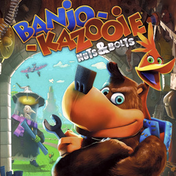

<h1 align=center>Banjo-Kazooie: Nuts &amp; Bolts on the Nintendo Switch</h1>

<b>renut-nx 1.0.4</b> · <a href="https://chanseyisthebest.github.io/renut-nx-webinstaller/">web installer</a> · <a href="https://github.com/ChanseyIsTheBest/renut-nx/releases/tag/v1.0.4">release</a>

An unofficial Switch port (formerly banjo-nx) of [reNut](https://github.com/masterspike52/reNut), masterspike52's
static recompilation of the Xbox 360 version of **Banjo-Kazooie: Nuts & Bolts**, built on the
[ReXGlue SDK](https://github.com/rexglue/rexglue-sdk). No emulator. Built on the ultimate base shared by
ChanseyIsTheBest's Switch ports ([docs/ultimate/](docs/ultimate/)).

This repository contains no game files. You need your own copy of the game: your Xbox 360 disc image (or the folder it
was extracted to), title update 3's package (`TU_16L61VD_0000004000000.00000000000O1`) and, optionally, the DLC
(`E41F20AAF7094B9AFCA8CC90489D689D72A5062B4D`).

## Playing it on the Switch

Needs Atmosphère and Sphaira.

1. Open the web installer: **https://chanseyisthebest.github.io/renut-nx-webinstaller/**
   ([source](https://github.com/ChanseyIsTheBest/renut-nx-webinstaller)).
2. Choose your game, title update 3's package and the DLC (optional), press **Create renut-nx.zip** and wait while it
   makes the shaders. It runs in your browser and uploads nothing.
3. Extract `renut-nx.zip` to the root of your SD card (it makes `switch/renut-nx/`).
4. In **Sphaira**, find Banjo-Kazooie Nuts & Bolts, press X for Options, choose **Install Forwarder**, set
   **Address Space** to **39-bit**, choose **Create Forwarder**, then start the game from the Home Screen.

Start it through the forwarder: that is how it gets all four CPU cores (a title takeover can't).

**Updating from 1.0.3:** replace `switch/renut-nx/renut-nx.nro` with the release's `renut-nx.nro`. Your shader files,
settings and saves stay as they are.

**Updating from 1.0.2 or older:** make the package again with the web installer (the old shaders don't work with
1.0.3 and later). Delete the old `switch/renut-nx/game_root/` before extracting and keep a copy of your `renut.toml` if you
changed it; saves in `switch/renut-nx/renut/` stay where they are.

Features:

- Title update 3, with the DLC (L.O.G.'s Lost Challenges) if you give it.
- reNut's renderer on deko3d, the Switch's own GPU API.
- Dynamic resolution (540p-720p handheld, 540p-1080p docked), MSAA and SMAA.
- All 15 of the game's languages; by default it follows the Switch's language.
- Optional 1.0.0 look: its font and dialogue boxes.
- Four CPU cores from the forwarder: audio and the shader compiler on the fourth ([docs/four-core-mode.md](docs/four-core-mode.md)).
- Smaller install: packed game files (LZ4), Opus music and H.265 movies, about 4.2 GB instead of 6.6 GB.
- Settings in `switch/renut-nx/renut.toml`: language, MSAA, SMAA, dynamic resolution, fur detail, the 1.0.0 look, frame
  cap, four-core mode and controls. Everything else is built in.
- Logging off except crash logs (`switch/renut-nx/logs/rex/rex_crash.log`). For a bug report, set
  `log_level = "info"` in renut.toml and send the `logs/` folder.

## Building

See [app/README.md](app/README.md) (reNut's) and [docs/](docs/) for the Switch port:
[docs/deko3d-renderer.md](docs/deko3d-renderer.md), [docs/title-update-3.md](docs/title-update-3.md),
[docs/enhancements-reference.md](docs/enhancements-reference.md). The release NRO carries only the shaders the game
makes at run time; the web installer makes the rest.

## Credits and license

- [reNut](https://github.com/masterspike52/reNut) by masterspike52: the recompilation and its renderer, used here with
  the author's permission.
- [ReXGlue SDK](https://github.com/rexglue/rexglue-sdk) and its contributors.
- [plume](https://github.com/renderbag/plume) (rendering abstraction), with a deko3d back end written for this port.
- deko3d and uam by fincs and the devkitPro team; libnx; Mesa's GLSL compiler inside uam.
- XenosRecomp (hedge-dev), in reNut's version.
- Sister ports: sa2-nx, futari-nx, sasrt-nx, katamari-nx, kameo-nx and the Torchlight port's findings (2 MB blocks);
  the ports of the ultimate base (rr6-nx, vivapinata-nx, mk9-nx, fnxf_xiii, feedingfrenzy-nx and the others its
  docs/ultimate/ names); rr6-nx's and culdcept-nx's packed game files, Opus music and H.265 movies;
  UnleashedRecomp-NX; NetherSX2_nx's four-core layout; nfsmw-nx (StevensND); battd_nx; keflings-nx-installer's Xbox
  360 package reader in the web installer. Details in `docs/` and in each file's comments.

See [LICENSE](LICENSE) and [THIRD_PARTY_NOTICES.md](THIRD_PARTY_NOTICES.md). Banjo-Kazooie: Nuts & Bolts is © Microsoft
and Rare. This project is not affiliated with them.
